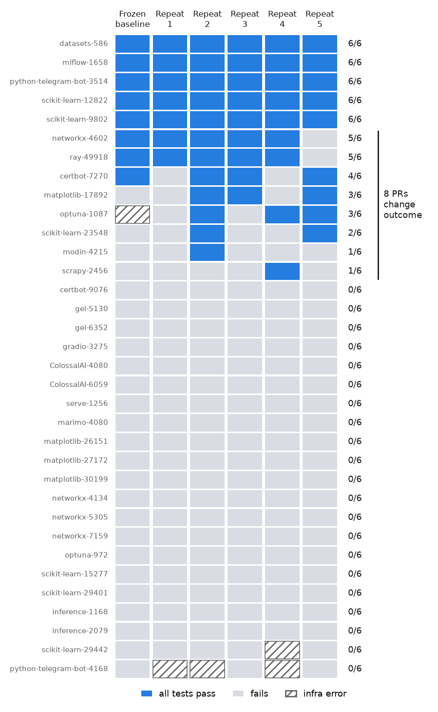
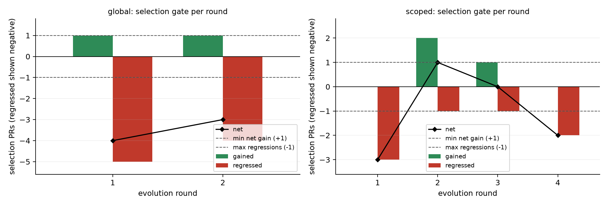
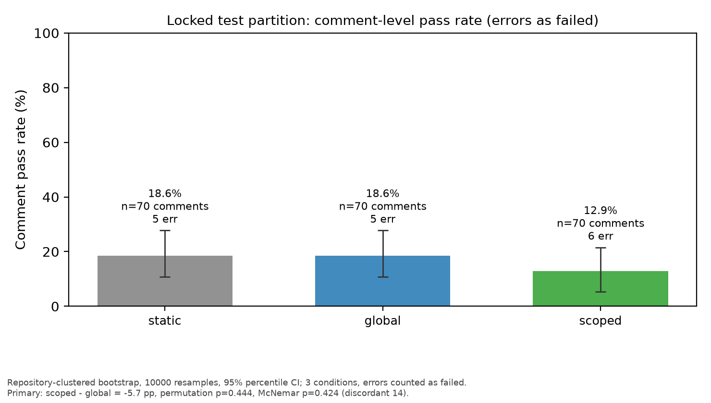
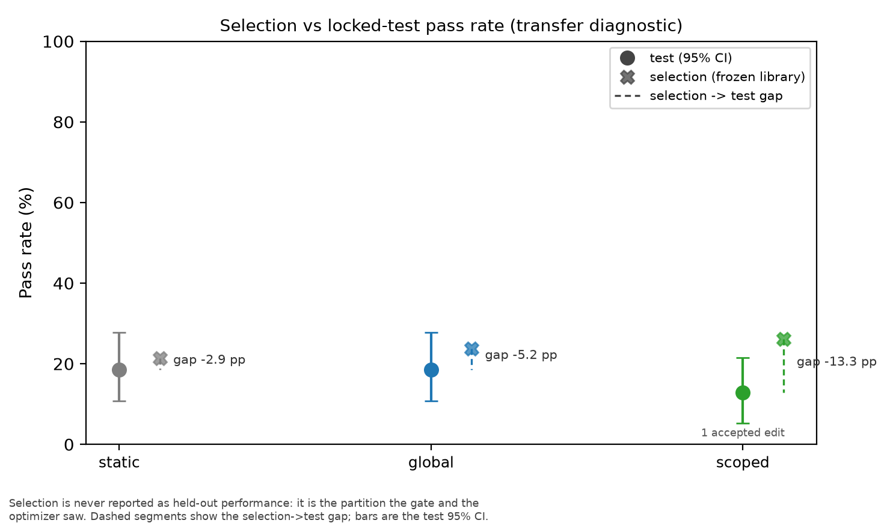

# Test-Guided, Scope-Aware Skill Evolution for Code Review Agents

**Final Report, CSE 572, Group 22**

Pradnya Sanjeev Nidagundi, Sachin Venugopalan Nair, Aman Shrivastava, Sai Rithwik Kukunuri

Arizona State University

> DRAFT STATUS (2026-11-27). All sections are written against final numbers, including the locked test pass. Citations use [@key] with the keys
> from Group22_Progress_Report_ACM/references.bib, so the LaTeX switch is mechanical. Blockquotes like this one
> are editorial notes; md2acmart.py turns them into LaTeX comments.

## Abstract

Code review agents do not learn from their past reviews, even when test results later show which comments were useful. We study whether a review agent can improve by turning sanitized test feedback into short textual skills, and whether splitting those skills into global and pull request (PR) type tiers transfers better to unseen repositories than one global library, when both use the same validation gate. We evaluate on c-CRAB, where a review counts as useful if a fixed repair agent acting on it makes a hidden test pass, using repository-disjoint splits and one open model, `qwen36-27b`, as reviewer, optimizer and repair agent. A static reviewer with no skills passes 24.3% of development comments and 21.4% of selection comments. Before evolution we measured the noise the gate must clear: five repeats of the same reviewer on the same 34 selection PRs passed between 9 and 14 of 42 comments, and 8 of 34 PRs changed outcome across repeats. The noise-calibrated gate therefore requires a net gain of 5 PRs, which is larger than any effect one skill edit is likely to produce. We therefore ran evolution under the weaker SkillOpt-style gate (net gain of 1) and report the calibrated gate as a sensitivity analysis. Over six rounds the optimizer proposed six generic, correctness-focused edits, all of them global. The gate accepted one, with a net of +1, which is within the noise band, and the calibrated gate would have rejected all six. The scoped library therefore froze with one global skill and the global library froze empty. On the locked test set of 70 comments from 21 unseen repositories, the scoped library passed 12.9% of comments against 18.6% for the global library (difference −5.7 points, 95% CI −15.5 to +4.3, permutation p = 0.44). That is no detectable difference, and it points against our hypothesis. Our main finding is that at this benchmark size, repair noise and not skill organization decides most gate outcomes.

**Keywords:** code review, LLM agents, skill evolution, repository shift, validation gating

## 1. Introduction

Code review catches defects and spreads knowledge within a team, but it takes a lot of developer time [@bacchelli2013]. This has led to models that generate review comments [@li2022codereviewer] and, more recently, to LLM agents that review whole PRs [@zhang2026ccrab]. These agents are static. If a comment turns out to be useless, the agent will make the same kind of comment on the next PR.

LLM agents can improve without retraining by writing lessons into text that they read later [@shinn2023reflexion; @wang2023voyager]. SkillOpt [@yang2026skillopt] keeps such lessons in a skill library and accepts a change only if it helps on a validation set. Code review fits this idea well because c-CRAB [@zhang2026ccrab] gives an objective signal: a comment is useful if acting on it makes a failing test pass.

Current skill methods keep one global list [@yang2026skillopt; @liu2026dynamics]. We think this is a problem for code review. Advice learned on bug fixes may not help on a new feature, and since only a few skills fit in the prompt, a wrong skill takes the place of a useful one. Our research question is: **under repository shift, does a library split into global and PR-type-scoped skills give a higher held-out c-CRAB pass rate than a single global library, when both use the same validation gate?** We expected the scoped library to pass more comments and to cause fewer regressions per accepted edit.

The comparison only means something if three conditions hold. No repository may appear in more than one partition, so the test estimate measures transfer to unseen code. The two conditions must differ in exactly one respect, so the reviewer, repair agent, token budget, optimizer and gate are shared and only the organization of the library changes. And the test partition is scored once, after the system is frozen. We wrote these rules, the gate calibration and the analysis plan into a pre-registered protocol before any final run, and we record every later change as a dated amendment.

The protocol also made us measure something the pilot could not: how much the outcome of the same review changes when the repair agent runs again. That measurement turned out to be the central result. Our contributions are:

1. a test-guided skill evolution pipeline for code review on c-CRAB, with repository-disjoint splits, a sanitized feedback channel that hides tests and gold comments from the optimizer, and a guarded, single-pass test partition;
2. a direct measurement of repair noise on the selection set, from five repeated runs of an unchanged reviewer, and the gate threshold it implies;
3. a controlled comparison of scoped and global skill libraries under a shared gate, scored once on 70 held-out comments from 21 unseen repositories, which finds no detectable difference, together with an analysis of what the optimizer actually proposed;
4. an analysis of why, at this sample size, the gate cannot separate real skill improvements from noise, and what a test of this question would need.

## 2. Related Work

**Code review and its evaluation.** Bacchelli and Bird [@bacchelli2013] found that developers mainly expect review to find defects, but much of it ends up being about code improvements and understanding. CodeReviewer [@li2022codereviewer] trained a model to write review comments and scored them by text similarity to human comments. That metric rewards wording, not usefulness. SWE-bench [@jimenez2024swebench] moved coding evaluation toward running real tests. c-CRAB [@zhang2026ccrab] brings this idea to code review. A fixed repair agent applies the review, and tests built from human review comments check whether the problem was fixed. The best of four released tools passes 32.1% of comments, and all four together pass 41.5%. Code Review Bench [@zverianskii2026crb] instead scores precision and recall against human-verified findings. We planned to use it as an outside test set and dropped it for time (Section 6.4).

**Self-improving agents.** Reflexion [@shinn2023reflexion] stores verbal feedback from failures and uses it on the next attempt. Voyager [@wang2023voyager] grows a library of reusable skills that it retrieves for new tasks. OPRO [@yang2024opro] and DSPy [@khattab2024dspy] treat the prompt as something to optimize from scores. SkillOpt [@yang2026skillopt] adds a validation gate to skill updates: a candidate is accepted only if at least one more validation task passes and at most one regresses. Liu et al. [@liu2026dynamics] show that gains can stall or reverse over many rounds.

**Gap.** These skill methods use one global library, and c-CRAB has only been used to evaluate static reviewers [@zhang2026ccrab]. We found no prior work that tests whether scoping skills by the type of change helps them transfer to new repositories. We also found no work that measures how noisy the validation signal itself is when the task outcome comes from a stochastic agent. SkillOpt's gate assumes a gain of one task is meaningful. Section 5.2 tests that assumption on c-CRAB.

## 3. Data

We use the public c-CRAB release [@zhang2026ccrab], pinned at commit `856dfa3`. Each instance is a Python PR with its diff, title, description, commits and one or more human review comments. Each comment has an executable test that fails before the fix and passes after it, so the outcome is pass or fail per comment. We reproduced the authors' filtering exactly from the released files (Table 1) and use the final 184 PRs (234 comments, 67 repositories). PR types come from the `problem_domain` field: 67 bug fix, 68 feature and 49 other.

| Stage | PRs | Comments |
|---|---|---|
| Full source test split | 671 | 1,313 |
| Comment filter (all have images) | 410 | 595 |
| Tests verified to fail, then pass | 339 | 485 |
| Resolved by repair agent (used) | 184 | 234 |

*Table 1: c-CRAB filtering, reproduced from the release.*

**Splits.** We assign whole repositories to one partition, so test repositories are never seen during development or gating. With a fixed seed (2685), we shuffle the repositories and fill the partitions in order, using only repository size and PR type mix, never outcomes. We keep a split only if it hits the target sizes exactly and every partition has all three PR types.

**Eligibility.** Two rules remove PRs before any sampling, using inputs only. Eight PRs have diffs over 120,000 characters (about 30,000 tokens), which the reviewer cannot read under its frozen cap. Three PRs have no accessible Docker image: one is reported missing by the c-CRAB maintainers, and two return `unauthorized` from the image registry on every retry. The same rules apply to every partition and condition. Table 2 gives the eligible sets, which are the denominators for every number in this report.

| Partition | Split PRs / comments | No image | Oversize | Eligible PRs | Comments | Repos | BF / F / O | Role |
|---|---|---|---|---|---|---|---|---|
| Development | 92 / 112 | 2 | 3 | 87 | 107 | 25 | 34 / 31 / 22 | feedback for the optimizer |
| Selection | 37 / 47 | 1 | 2 | 34 | 42 | 17 | 14 / 6 / 14 | gate only |
| Test (locked) | 55 / 75 | 0 | 3 | 52 | 70 | 21 | 19 / 24 / 9 | scored once |

*Table 2: Repository-disjoint splits and eligible sets. BF / F / O are bug fix, feature and other PRs.*

**Preprocessing.** We match each comment to its test. Before the optimizer sees any feedback, we remove test code, the human comment text, file paths, repository names and benchmark IDs (Section 4.3). Four test PRs have JavaScript tests; we keep them and score them as released.

**Composition.** Two properties of the data shape what we can conclude. The partitions are uneven. The eligible selection set has only 6 feature PRs, while the eligible test set has 24 out of 52, so the gate sees little evidence about the PR type that dominates the test estimate. On the full splits, the released tools pass 30.0% of test feature comments against 56.5% of bug-fix comments, so feature PRs are both the largest test stratum and the hardest. The *other* tier also aggregates seven source categories, so a skill learned for it draws on a mixture of change types.

## 4. Methods

### 4.1 Pipeline

For each PR, the reviewer gets the title, description and diff, plus up to 400 tokens of retrieved skills, and returns at most five findings as JSON. As in c-CRAB, Claude Code then applies these findings inside the PR's Docker image, and we run the PR's tests. A PR passes if all its tests pass. A comment passes if its own test passes; comment outcomes for one PR come from the same repair run.

**Model.** All three roles use `qwen36-27b`, hosted for free by ASU, at temperature 0 with thinking disabled. Claude Code only speaks the Anthropic API, so the harness starts a local LiteLLM proxy that translates its calls to the ASU endpoint. The proposal used Claude Sonnet 4.6 for repair, as the c-CRAB authors did. We switched because the pilot cost \$0.29 per PR evaluation, and the full study needs several thousand evaluations. Using one model for all roles keeps the internal comparison valid, but our absolute pass rates are not comparable to the released tools, which used their own models and repair setups.

**Failures.** A repair that times out (1,200 s), a Docker failure or an empty review after retries is an infrastructure error. Errors count as failed in the primary metric and are excluded from gate counts, so an error is never a regression.

### 4.2 Skills and retrieval

A skill is a review instruction of at most 60 words, tagged as global, bug fix, feature or other. In the *global* condition, all skills are global. In the *scoped* condition, retrieval first adds skills for the PR's type and then global skills. Both use the same rules: a 400-token budget, newest skill first within each scope, duplicates removed, at most 6 skills per prompt, and a skill that would overflow the budget is skipped so a smaller later skill can still fit. The *static* condition retrieves nothing.

### 4.3 Optimizer and sanitizer

Each round evaluates the current library on all 87 development PRs and makes one optimizer call. The optimizer sees only an allowlisted summary: pass counts per PR type over all development PRs, and up to 12 examples, failed PRs first, each with the PR type, the reviewer's own findings (at most 3, paths and line numbers replaced, capped at 600 characters) and how many of the PR's comments passed. It never sees diffs, test code, gold comments or selection results. Before every call, a check on the exact payload stops the run if it contains a PR ID, repository name, changed file path, gold comment text or test code. The optimizer proposes at most one edit per round (add, replace or delete). It is also told which edits the gate already rejected, so it does not propose them again.

### 4.4 Validation gate and its calibration

For a round, the current and candidate libraries are both evaluated on the same 34 selection PRs. With PR-level outcomes,

`gained` = PRs failing with the current library and passing with the candidate, `regressed` = the reverse, `net` = `gained` − `regressed`,

and the candidate is accepted if `net` ≥ τ and `regressed` ≤ 1.

SkillOpt fixes the gain at 1. The pilot suggested that one flipped PR could decide a round, so we did not fix τ in advance. Instead, before any evolution round, we evaluated the unchanged (empty) library on the selection set five times with fresh draws: same prompts, same PRs, same seed, no cache. Any gain or loss between these runs is noise. We compute `net` for each repeat against the first and set τ = max(1, ⌈95th percentile of |net|⌉). Section 5.2 reports the result. Because τ came out at 5, we amended the protocol before the first evolution round (Section 4.6).

### 4.5 Evolution loop

Each gated condition runs at most 5 rounds and stops after 2 consecutive rejections. A round consumes one round whether it is accepted or not, and a rejected candidate leaves the library unchanged. Both conditions use the same development and selection PRs, the same seed and the same round schedule, and run one after the other. Results are cached by PR, retrieved skills and draw salt, so a library evaluated once is never re-drawn.

### 4.6 Pre-registration and the locked test

We pre-registered the protocol on 2026-11-23, before any final-run data existed. It fixes the conditions, the gate rule and its calibration, the stopping rule, the primary metric and the statistics. The test partition is locked in code: sampling refuses test PRs unless an unlock flag is given, and the unlock checks a freeze record with the code hash, the library hashes and the test PR IDs. Each frozen library is scored once.

**Amendment A1 (2026-11-25, before any evolution round).** The calibrated gate (τ = 5) would have rejected every edit, so both libraries would have stayed empty and the test would have compared the static reviewer with itself. We changed the operating gate to τ = 1 (`net` ≥ 1, `regressed` ≤ 1), recorded the calibrated τ, and report for every round what the calibrated gate would have decided. We also dropped the planned ungated ablation, because the τ = 1 gate is already close to ungated (Section 5.2). The amendment used only the calibration data and is committed ahead of the first evolution round.

**Later amendments.** Every later change is in the protocol's amendment log with its date and the evidence used. None used test outcomes to choose anything.

* *A2–A4 (Phase B implementation bugs).* The first Phase B attempt ran 6 rounds instead of 5 and did not count empty-edit rounds toward the stop rule. One ASU firewall block on a single repair prompt stopped a whole run. We fixed all three, archived that attempt, and restarted both conditions from round 1. Later, the optimizer twice replied in a JSON shape our parser did not accept: once as a list wrapped in an object, and once as a single bare edit. Those rounds were recorded as "no edit" and counted as rejections. We fixed the parser, logged the optimizer's raw reply from then on, and re-ran only the affected rounds. The analysis keeps the latest record for each round.
* *A5 (freeze).* The freeze record pins the code, library hashes, test PR ids and a test salt. Global's frozen library is empty, like static's, and the two share a salt, so they share every cached draw. Global's test result equals static's on every PR that completed in both runs. They differ only where a repair errored, because errored repairs are not cached and get re-run (A6).
* *A6 (interrupted test pass).* The first locked test pass stopped at 37–38 of 52 PRs per condition. A memory-heavy repair exhausted the shared 8 GB host, and the local proxy that routes the repair agent to the model was killed. We capped each benchmark container at 1.5 GB, made a failure that persists while the proxy and endpoint are healthy an error for that PR instead of a stop, re-froze with the new code hash (same libraries, test ids and salt), and resumed each pass once. PRs that had already produced a result were kept and never re-drawn. The interrupted passes had printed partial pass counts to the run log; these did not inform any decision.
* *A7 (scope).* A planned extension, which gave the optimizer more detail about which kinds of concerns were missed, was not run, because of time and compute limits. We return to it as future work (Section 6.3).

### 4.7 Evaluation

**Primary metric.** Comment-level pass rate on the locked test partition, errors counted as failed: passing comments over all 70 comments of the 52 eligible test PRs. The primary contrast is scoped versus global, two-sided. Static is a reference point, not a treatment arm.

**Statistics.** We report a 95% confidence interval from a bootstrap that resamples the 21 test repositories (10,000 resamples) [@efron1993bootstrap; @field2007clustered], because comments inside one repository share conventions and treating them as independent would make intervals too narrow. We test the paired difference with a sign-flip permutation test across repositories (10,000 permutations) and McNemar's test on paired comment outcomes, and we report discordant-pair counts.

**Secondary metrics.** PR-level pass rate; pass rate excluding errors; errors per condition; accepted and rejected edits; net gain and regressions per accepted edit; the gap between selection and test pass rate; tokens and wall-clock time per passing review; retrieval statistics; and the run-to-run flip rate. All secondary metrics are exploratory.

## 5. Results

All numbers come from `qwen36-27b` in all three roles. No number in Sections 5.1 to 5.3 depends on test outcomes.

### 5.1 Static baseline

The static reviewer, with no skills, passes 26 of 107 development comments (24.3%, repository-clustered 95% CI 17.1% to 30.8%) and 9 of 42 selection comments (21.4%, CI 10.4% to 34.8%). At the PR level, 18 of 87 development PRs and 8 of 34 selection PRs pass all their tests. Three development PRs and one selection PR ended in infrastructure errors.

For reference, the released tools on the same eligible comments: Claude Code passes 27.1% of development and 42.9% of selection comments, and the union of all four tools passes 39.3% and 47.6%. On the eligible test comments they reach 35.7% (Claude Code) and 44.3% (union). These numbers come from the c-CRAB release, with each tool's own model and repair setup. They are not a controlled comparison with our reviewer, which uses a 27B open model in every role.

### 5.2 Gate calibration: how noisy is the selection signal?

Table 3 shows the five repeated runs of the unchanged reviewer on the 34 selection PRs. The comment-level pass rate ranged from 21.4% to 33.3%, a spread of 5 comments, with nothing changed but the random draw of the reviewer and repair runs.

| Repeat | Passed / 42 | Rate | Errors | vs repeat 1: gained / regressed / net |
|---|---|---|---|---|
| 1 | 9 | 21.4% | 1 | — |
| 2 | 14 | 33.3% | 1 | 5 / 0 / +5 |
| 3 | 11 | 26.2% | 0 | 2 / 0 / +2 |
| 4 | 11 | 26.2% | 2 | 2 / 0 / +2 |
| 5 | 9 | 21.4% | 0 | 4 / 2 / +2 |

*Table 3: Five A/A repeats of the static reviewer on the selection set. Gained / regressed are PR-level, errored PRs excluded.*

**Threshold.** The 95th percentile of |`net`| against repeat 1 is 4.55, so τ = 5. Using all 10 pairs of repeats instead gives the same τ, with nets between −3 and +5.

**Where the noise comes from.** The noise sits in a few PRs. Across the five repeats, 5 PRs passed every time, 21 never passed, and 8 (23.5%) changed outcome at least once. Two PRs had fewer than five valid runs because of errors. So 26 of 34 selection PRs carry no signal for a gate, and a candidate's `net` is mostly decided by which way the 8 unstable PRs fall in that run.

**What the gate would accept by chance.** We applied each gate to pairs of repeats, which have no real difference between them. The τ = 1 rule accepted 6 of the 20 ordered pairs (30%). Against the frozen baseline that round 1 actually compares to, it accepted 2 of 5 repeats. The SkillOpt rule (`gained` ≥ 1, `regressed` ≤ 1) also accepted 6 of 20. A null edit therefore passes a SkillOpt-style gate roughly a third of the time. At τ = 5, a real edit would have to beat the largest difference we saw between two identical runs, which is more than one 60-word skill is likely to do.

### 5.3 Evolution

Table 4 lists every evaluated round. Global stopped after two rejections. Scoped ran four rounds: one accepted edit, then two rejections.

| Condition | Round | Proposed skill (first words) | Scope | Words | Selection comments | Gained / regressed | Net | τ = 1 | τ = 5 |
|---|---|---|---|---|---|---|---|---|---|
| Global | 1 | "Prioritize identifying runtime errors … over stylistic or documentation issues" | global | 46 | 10 → 5 | 1 / 5 | −4 | reject | reject |
| Global | 2 | "Verify type consistency in set operations … convert dict_keys to set" | global | 56 | 10 → 8 | 1 / 4 | −3 | reject | reject |
| Scoped | 1 | "Prioritize high-impact correctness issues … avoid nitpicking documentation or style" | global | 30 | 10 → 8 | 0 / 3 | −3 | reject | reject |
| Scoped | 2 | "Validate API contract compliance: arguments match expected types, keys exist …" | global | 49 | 10 → 11 | 2 / 1 | +1 | **accept** | reject |
| Scoped | 3 | "Verify semantic correctness of logic, not just syntax …" | global | 42 | 11 → 13 | 1 / 1 | 0 | reject | reject |
| Scoped | 4 | "Verify variable scope and initialization order to prevent UnboundLocalError …" | global | 55 | 11 → 10 | 0 / 2 | −2 | reject | reject |

*Table 4: Every evaluated evolution round. Selection comments: comments passed out of 42 with the current library → with the candidate. Gained / regressed are PR-level. τ = 1 is the operating gate (A1), τ = 5 the calibrated gate.*

**One edit was accepted, and it is indistinguishable from noise.** Of six candidates, five had a net of 0 or below. Three of those lost more selection PRs than any edit gained, and global round 1 regressed 5 PRs. The one acceptance, scoped round 2, had a net of +1. Identical runs produced nets of +1 and +2 (Section 5.2), and the calibrated gate would have rejected every candidate. The frozen libraries are therefore *global*: empty, and *scoped*: one global skill.

**The accepted skill did not help on development either.** In scoped rounds 3 and 4, the development pass with the accepted skill passed 21 of 107 comments (19.6%, 2 errors), against 26 of 107 (24.3%) for the static reviewer. That difference of 5 comments is inside the noise band too, but it points the same way as most selection results.

**The optimizer never used scoping.** All six proposals were global skills, including the four in the scoped condition, which could have written bug-fix, feature or other skills. The proposals are also generic. Each tells the reviewer to look harder for correctness problems (undefined variables, types, imports, API contracts), and two explicitly tell it to avoid style and documentation comments. The specific details (dict_keys, error codes, HTTP status codes, truthy assertions) come straight from the reviewer's own findings in the feedback, which are findings on PRs where the review failed. The optimizer sees *that* those reviews failed, but not *what* the human reviewer had asked for. So it can only restate the review that failed in more general words.

**Phase B cost.** The two conditions needed 6 candidate selection passes and 2 fresh development passes with a skill in the library, plus cached passes. Runs moved to a 4-core x86 server mid-phase (Section 5.5).

### 5.4 Locked test

Each frozen library was scored once on the 52 eligible test PRs (70 comments, 21 repositories), with the same test salt (Table 5).

| Condition | Library | Comments passed | Pass rate (95% CI) | PRs all-pass | Errors | Complete-case rate |
|---|---|---|---|---|---|---|
| Static | none | 13 / 70 | 18.6% [10.8, 27.8] | 9 / 52 | 5 | 21.0% |
| Global | empty | 13 / 70 | 18.6% [10.8, 27.8] | 9 / 52 | 5 | 21.0% |
| Scoped | 1 global skill | 9 / 70 | 12.9% [5.3, 21.6] | 7 / 52 | 6 | 14.1% |

*Table 5: Locked test pass, comment level, errors counted as failed. The CI is a repository-clustered bootstrap. The complete-case rate excludes the comments of errored PRs.*

**Primary contrast.** Scoped minus global is −5.7 points (95% CI −15.5 to +4.3). The pre-registered paired permutation test across repositories gives p = 0.44. Of the 70 paired comments, 14 are discordant: 5 pass only under scoped and 9 only under global (exact McNemar p = 0.42). At the PR level, scoped gained 3 PRs and lost 5. We find no detectable difference, and the point estimate is in the opposite direction from H1.

**Global equals static.** Their frozen libraries are both empty and they share a test salt, so they share every cached draw. The two results agree on all 70 comments, errors included, which makes "global minus static" exactly zero.

**Errors.** Scoped errored on 6 of 52 PRs (11.5%). That is above the 10% bar in our protocol, so we report the complete-case rate next to the primary one: 14.1% for scoped against 21.0% for global and static. The ordering is the same. Errors come from repairs that time out, exhaust their container, or are blocked by the endpoint's firewall; one PR, `zulip-25349`, was blocked for every condition.

**By PR type.** Scoped passes fewer feature comments than global (2 of 37 against 6 of 37) and fewer bug-fix comments (6 of 23 against 7 of 23), and one more of the 10 *other* comments. The counts are too small to read further.

**Transfer.** Selection overstated test performance for every condition, which is the expected direction for a partition the gate looked at. The gap is −2.9 points for static and −13.3 points for scoped, whose selection estimate (26.2%) comes from the very run that accepted its skill.

### 5.5 Cost

Hosting was free, so we report tokens and wall-clock time instead of dollars. The static baseline used 34.3M tokens on development (about 394k per PR) and 14.2M on selection (about 417k per PR). More than 99% of tokens are prompt tokens of the repair agent, which re-sends its growing context on every agent turn. By the freeze, the ledger held 280M repair tokens, 3.6M review tokens and 0.09M optimizer tokens. On a laptop, one selection pass of 34 PRs took 50 to 55 minutes with three workers, because the amd64 Docker images run under emulation on Apple Silicon. We moved Phase B and the test pass to a 4-core, 8 GB x86 server, where repairs run natively: one repair took 91 s instead of about 230 s. Memory, not CPU, limited the server to two or three parallel repairs (A6).

On the test pass, the static reviewer used about 3.0M tokens and 39 minutes of evaluation time (review plus repair) per PR that passed all its tests. Scoped used 4.7M tokens and 44 minutes per passing PR. It spent more tokens per PR (636k against 522k, mostly in the repair agent) and passed fewer PRs.

## 6. Discussion

### 6.1 The gate cannot see effects this small

The calibration shows that our selection set cannot tell a useful skill edit from a lucky run. Two identical runs differed by up to 5 PRs, and 8 of 34 PRs changed outcome with nothing changed. Any gate on this signal is either too strict to accept anything (τ = 5) or loose enough to accept about a third of null edits (τ = 1, and the SkillOpt rule). This is not a flaw of the scoped design or of our optimizer. It holds for any method that validates skill edits on 34 c-CRAB PRs with a stochastic repair agent, and it applies to the SkillOpt gate as published, which assumes that one extra passing task is evidence.

### 6.2 What our comparison does and does not test

Under amendment A1, both libraries evolve under a permissive gate, so the edits that survive are not filtered for quality. The scoped-versus-global contrast therefore tests how the library is *organized*, not how well a gate *filters* edits. H2, about net gain and regressions per accepted edit, has to be read against the noise band of Section 5.2: a single accepted edit with a net of +1 or +2 is within what two identical runs produce. The test result fits this reading. The one edit the gate let through was a generic, global skill accepted on noise. It came out 5 comments worse on development and 4 comments worse on test, so the scoped library ended up worse than the empty library. The scoped arm never wrote a PR-type skill, so this result says nothing for or against scoping as such. It is evidence that a permissive gate on a noisy signal lets weak edits through, and that the optimizer, as built, had nothing better to offer.

### 6.3 What a real test would need

Two things are missing: a richer learning signal, and a quieter measurement.

**A richer signal.** Section 5.3 shows the optimizer restating failed reviews, because the feedback says that a review failed but not why. A natural next step is to tell the optimizer what *kind* of concern was missed, without the gold wording, file or line. For example, a coarse category label per missed comment, and whether any finding touched the right file. That would also give it a reason to write PR-type skills, which scoping needs and which it never produced here. Time and compute limits prevented us from exploring this, and it is the first thing we would study next.

**A quieter measurement.** A gate can only detect an effect larger than the noise it has to clear. Three changes would get there. First, repeat each selection evaluation several times and gate on the mean, which costs one extra selection pass per repeat. Second, drop the PRs that never or always pass from the gate, since they carry no information, and spend the budget on the unstable ones. Third, use a larger selection set. With 8 of 34 PRs unstable, the noise in `net` grows roughly with the square root of the set size while a real per-PR effect grows linearly, so a much larger selection set would be needed for a one-skill effect to clear it.

### 6.4 Limitations

The model is a 27B open model in all three roles, so our absolute pass rates are not comparable to the released tools or to our Sonnet 4.6 pilot. Compute limited how many repeats we could afford: emulation on the laptop, then a shared 8 GB server. We did not run a control that replaces the reviewer's findings with generic text, so we cannot say how much of the repair agent's success comes from the findings rather than from the diff alone. Four test PRs have JavaScript tests and may fail for environment reasons. We dropped Code Review Bench as an outside test set, so external validity rests on the repository-disjoint test partition alone. We did not run the planned blind labelling of findings. The selection set has only 6 feature PRs, so the gate knows little about the PR type that dominates the test estimate.

## 7. Conclusion

We built a test-guided skill evolution pipeline for code review agents, with repository-disjoint splits, a feedback channel that hides tests and gold comments from the optimizer, and a test partition that is scored once. Before evolving anything, we measured how much the selection outcome changes between identical runs, and found it changes by up to 5 of 34 PRs. A gate calibrated to that noise accepts nothing, and a SkillOpt-style gate accepts about a third of edits that change nothing. On 70 held-out comments, the scoped library (one accepted skill) passed 12.9% against 18.6% for the empty global library, a difference we cannot distinguish from zero (p = 0.44), and the optimizer never used the scoping it was offered. Whether scoped skills transfer better than global ones remains open; testing it on c-CRAB needs a validation signal several times less noisy than one run per PR.

## References

> Reuse Group22_Progress_Report_ACM/references.bib unchanged. Keys cited here: bacchelli2013, li2022codereviewer,
> zhang2026ccrab, shinn2023reflexion, wang2023voyager, yang2026skillopt, liu2026dynamics, jimenez2024swebench,
> zverianskii2026crb, yang2024opro, khattab2024dspy, efron1993bootstrap, field2007clustered.
