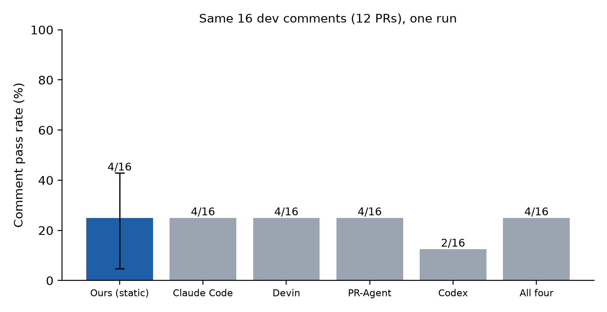

# Test-Guided, Scope-Aware Skill Evolution for Code Review Agents

**Group 22:** Pradnya Sanjeev Nidagundi, Sachin Venugopalan Nair, Aman Shrivastava, Sai Rithwik Kukunuri

*Progress report (intermediate draft of the final report). To be converted to the ACM SIGKDD `acmart` template (`sigconf`, `authorversion`, `nonacm`; 8 pages excluding references and appendices) before submission. Every number below comes from `results/` (`summary.json`, `census.json`, `splits.json`, `released_tools.csv`) and `runs/ledger.jsonl`.*

> **Section status.** Complete or near-complete: Data, Methods. Drafted from the proposal, for the team to refine: Abstract, Introduction, Related Work. Initial results only: Results, Discussion. **To be filled: Conclusion, and the final results.**

---

## Abstract

*[Draft, to be finalized once the main experiments are done.]*

Automated code review agents are typically static after deployment: they do not retain lessons from earlier reviews, even when later test results show whether their feedback was useful. We study whether a self-evolving review agent can improve by converting sanitized, test-based feedback into reusable textual skills, and whether organizing those skills into a global tier and PR-type-scoped tiers (bug fix, feature, other) improves generalization to unseen repositories compared with a single global skill library. Both variants use the same validation gate, which accepts a candidate skill edit only if it helps on a held-out selection set without causing more than one regression. We evaluate on the c-CRAB benchmark, where a review is scored by whether a fixed repair agent's fix passes an executable test derived from a human review comment, using repository-disjoint development, selection and locked test splits.

At this stage we have built and verified the full pipeline (data preparation, reviewer, repair-and-test harness, skill library, sanitizer, optimizer and validation gate) and ran a small preliminary study (12 development PRs, 8 selection PRs, one evolution round per condition, $10.69 in API spend). A static reviewer without learned skills passes 4 of 16 comments (25.0%), comparable to released tools on the same comments, and both conditions' first candidate edits were rejected by the gate. These runs establish feasibility and measured costs but are too small to support or refute our hypothesis. *[Final results: TBD.]*

---

## 1. Introduction

Large language model (LLM) agents are increasingly used to review pull requests (PRs), but a deployed reviewer is usually fixed. If its comments later turn out to be useful or useless, nothing in the system learns from that outcome. Recent work on self-evolving agents shows that persistent textual instructions ("skills") can be improved from feedback [2, 3]. Code review offers an unusually good setting for this idea, because the c-CRAB benchmark [1] provides an objective, executable signal: a review comment is useful if acting on it makes a previously failing test pass.

Existing skill-evolution methods optimize a single global skill set [2, 3]. Guidance learned from one kind of change can be irrelevant or harmful for another: a skill about input validation learned on bug fixes may distract a reviewer looking at a documentation change. We therefore ask:

> **Research question.** Under repository shift, does organizing evolved skills into global and PR-type-scoped tiers improve held-out c-CRAB pass rate compared with a single global skill library, when both use the same validation gate?

**Hypothesis.** The scoped library achieves a higher held-out pass rate with fewer regressions per accepted edit, because it keeps type-specific guidance from being applied to unrelated PRs.

**Progress so far.** We have (i) reproduced the c-CRAB data funnel and built repository-disjoint splits, (ii) built a skill-aware review agent, a repair-and-test harness, a leakage-controlled feedback sanitizer, an edit optimizer and a validation gate, (iii) verified these with offline tests and independent code review, and (iv) run a small preliminary study that gives measured costs and exposes design risks. We do not yet have evidence about the research question.

**Roadmap.** Section 2 reviews related work, Section 3 describes the data, Section 4 our methods and evaluation protocol, Section 5 the preliminary results, Section 6 discusses limitations, deviations from the proposal, cost and remaining work, and Section 7 concludes.

---

## 2. Related Work

*[Drafted from the proposal's related-work text; the team should expand it with additional citations.]*

**Code review benchmarks and agents.** c-CRAB [1] evaluates whether automated review comments are actionable. A fixed coding agent applies a review, and executable tests, each derived from a human review comment, determine whether the resulting change fixes the concern. The authors evaluate four existing reviewers, PR-Agent, Devin, Claude Code and Codex, and report that together they solve around 40% of the tasks. c-CRAB has so far evaluated only static reviewers. Code Review Bench [4] provides 50 PRs with 173 human-verified findings, and we hold it out as an external test set.

**Self-evolving agent skills.** SkillOpt [2] studies how persistent textual skills can be improved using feedback and validation, accepting updates only when they pass a validation check. A related study of feedback dynamics [3] examines whether learned skills continue to improve across multiple evolution rounds.

**Gap.** Both skill-evolution methods [2, 3] optimize a single global skill set, and c-CRAB [1] has evaluated only static reviewers. It therefore remains unclear whether skills scoped to the type of change transfer better to unseen repositories. Our work evaluates a scoped skill library in code review under repository shift, using the same validation gate as the global baseline so that the only difference is the organization of the library.

---

## 3. Data

**Primary dataset.** We use the public c-CRAB release [1], pinned at commit `856dfa3`. Each instance is a Python-labeled pull request containing the diff under review, the PR title and description, base and merged commits, and one or more human review comments, each converted into an executable test that fails before the fix and passes after it.

**Census.** We reproduced the authors' curation funnel directly from the released files:

| Stage | PRs | Comments |
|---|---|---|
| 0. Full SWE-CARE test split | 671 | 1313 |
| 1. Comment filter | 410 | 595 |
| 2. Docker image available | 410 | 595 |
| 3. Tests verified (fail → pass) | 339 | 485 |
| 4. Resolved by the repair agent (**used here**) | **184** | **234** |

The final set spans 67 repositories. PR types come from the released `problem_domain` field: bug fix (67), new feature (68) and other (49, the remaining seven categories).

**Repository-disjoint splits.** Repositories are assigned whole to one of three partitions with a fixed seed (2685), using only sizes and PR types and never outcomes. The search matched every target from the proposal exactly and gave each partition all three PR types:

| Partition | PRs | Comments | Repos | Bug fix | Feature | Other |
|---|---|---|---|---|---|---|
| Development | 92 | 112 | 25 | 34 | 35 | 23 |
| Selection | 37 | 47 | 20 | 14 | 7 | 16 |
| Test (locked) | 55 | 75 | 22 | 19 | 26 | 10 |

**Released-tool performance on our partitions.** Rescoring the released per-tool outputs reproduces the published full-benchmark rates exactly (Claude Code 32.1%, Devin 24.8%, PR-Agent 23.1%, Codex 20.1%, union 41.5%). Pass rate is the fraction of the partition's comments whose test passes; a tool with no result for a comment counts as failing, as in the original scoring.

| Partition (comments) | Claude Code | Devin | PR-Agent | Codex | All four |
|---|---|---|---|---|---|
| Development (112) | 25.9% | 25.0% | 20.5% | 10.7% | 37.5% |
| Selection (47) | 42.6% | 29.8% | 29.8% | 36.2% | 48.9% |
| Test (75) | 34.7% | 21.3% | 22.7% | 24.0% | 42.7% |

**Preprocessing and data-quality notes.**
- *Sanitization.* Feedback given to the optimizer has test source, gold review wording, file paths and identifiers removed (Section 4.4).
- *Language.* Four of the 184 PRs (three ccxt, one zulip; all in the test partition) have JavaScript tests, not Python.
- *Missing images.* The proposal says two PRs have no prebuilt image. The image report lists `python__cpython-104029` (in our selection set) and `python__cpython-30745` (not in the 184) as skipped. We exclude the first.
- *Oversize diffs.* Eight PRs have diffs over 120,000 characters (largest about 711,000), which overflow the repair agent's context. We exclude these from sampling for every condition (3 development, 2 selection, 3 test). This biases samples toward smaller PRs and needs a team decision for the test set.
- *Thin strata.* Selection has only 7 feature PRs, so per-type analysis there is limited.

**External test set.** Code Review Bench [4] (50 PRs, 173 findings) is held out and will be scored once, with the frozen system. It has not been touched.

---

## 4. Methods

### 4.1 Review agent
A single pinned model (Claude Sonnet 4.6, temperature 0, via LiteLLM) receives the PR title, description, diff and a fixed token budget (400 tokens) of retrieved skills, and returns at most five findings as validated JSON (file, line range, issue header, issue content). No gold data is reachable by construction.

### 4.2 Repair-and-test harness (evaluation)
We reuse the c-CRAB flow. Each review is turned into the vendor's repair prompt and applied by Claude Code (Sonnet 4.6) in the PR's Docker container, and each of the PR's Stage 4 tests is run on the result. The metric is the **comment-level pass rate**: the fraction of review concerns whose executable test passes. A **PR passes** only if all of its tests pass. Differences from the vendor harness: we use an API key instead of a credentials file, run only Stage 4 tests, and cap each repair at $1.50. Images are amd64-only and run under emulation on arm64 hardware. Infrastructure failures (for example a repair timeout) are recorded as errors, excluded from gate comparisons, and counted as failures in reported pass rates.

### 4.3 Skill library and retrieval
Skills are short textual instructions tagged `global`, `bug_fix`, `feature` or `other`. In the **scoped** condition, retrieval returns the skills for the PR's type first and then global skills; in the **global** condition all skills come from a single pool. Both conditions use the same 400-token budget.

### 4.4 Feedback sanitizer
The optimizer sees only an allowlisted view: the PR type, the reviewer's own finding text with paths and file names removed, and a count of tests passed out of total. A check on the exact payload fails the run if it contains test source, gold comment text, a repository name, an instance identifier or a file path.

### 4.5 Optimizer and validation gate
After a development-set round, an optimizer (same model) proposes at most two edits (add, replace or delete) to the library. Following the validation gating of SkillOpt [2], a candidate library is accepted only if **at least one more selection PR passes and at most one regresses** relative to the current library. PRs with infrastructure errors are excluded from the comparison.

### 4.6 Experimental conditions
Static reviewer (no skills); global gated evolution (SkillOpt-style baseline); scoped gated evolution (our method); and, planned, scoped evolution without gating.

### 4.7 Planned evaluation protocol
Primary comparison: scoped vs global gated evolution on the locked test partition (75 comments, 55 PRs, 22 repositories), with the same repair agent, model and harness for all conditions. We will report a 95% repository-clustered bootstrap confidence interval and a paired permutation test; regressions per accepted edit; the gap between selection and test pass rate as a measure of transfer; cost and tokens per passing review; skill retrieval frequency; and the run-to-run flip rate over three repeated runs. Two team members will blind-label a sample of disagreement cases (correct and actionable, correct but not actionable, incorrect or irrelevant) with Cohen's κ. The frozen final system is scored once on Code Review Bench [4].

### 4.8 Engineering safeguards
A spend ledger with a hard cap is checked before every paid call; results are cached by content so repeated evaluations are free; benchmark Docker images are deleted by exact tag after use; secrets are scrubbed from everything written to disk; and the system is blocked in code from running on the locked test partition. The data code and harness were independently reviewed before any money was spent, key behaviors were mutation-checked (break the logic, confirm a test fails), and the last two small commits (narrowed fatal-error check, image cleanup) have offline tests but no independent review.

---

## 5. Results

*[Preliminary. Small single-run samples; not evidence for or against the hypothesis. Final results: TBD.]*

### 5.1 Static baseline
On 12 development PRs (16 comments) the static reviewer passes 4 of 16 comments, **25.0%** (repository-clustered bootstrap 95% CI 4.8% to 42.9%). One PR hit the 600-second repair timeout and counts as failed (26.7% if excluded). On the same 16 comments, the released tools score as follows (Figure 1):

| Reviewer | Passed (of 16) |
|---|---|
| Ours, static | 4 |
| Claude Code / Devin / PR-Agent | 4 / 4 / 4 |
| Codex | 2 |
| All four combined | 4 |

Our static reviewer is indistinguishable from the released tools on this sample; with 16 comments the data say almost nothing about which is better.

### 5.2 Gated evolution, one round per condition
Feedback came from the 12 development PRs and the gate from 8 selection PRs (9 comments).

| Condition | Edits proposed | Selection pass, baseline → candidate | Gained / regressed | Decision |
|---|---|---|---|---|
| Global | 2 (both global) | 5/9 → 4/9 comments | 0 / 1 | Rejected |
| Scoped | 2 (1 global, 1 bug_fix) | 5/9 → 4/9 comments | 0 / 1 | Rejected |

Both libraries therefore remain empty and the conditions are identical in outcome. One regressed PR out of eight is within plausible run-to-run noise, so we cannot say whether the edits hurt. A second round would not help: the optimizer is deterministic and with an unchanged library would propose the same edits and hit the cache.

### 5.3 Qualitative observations
- The proposed edits are generic checklist items (duplicate assignments, identical if/else branches, parameter validation).
- One scoped edit contains a code snippet (`self.need_unique_check = True`) copied from the reviewer's own finding on a pandas development PR. The sanitizer removes paths and file names but not code identifiers, so the optimizer can overfit to a single PR. This is not gold-data leakage (the text is the reviewer's own output) but is a generalization risk.

### 5.4 Cost and runtime
- **Total spend $10.69** (37 repairs, 37 reviews, 2 optimizer calls), against a self-imposed $25 limit and a $22 code cap.
- **Mean cost per PR evaluation $0.29** (review about $0.03, repair about $0.26). The $1.50 timeout is counted at its maximum because the true cost is unknown; oversize PRs are excluded and would cost more.
- About 20 minutes for 12 PRs on an arm64 laptop, because the amd64 images run under emulation with 2 parallel workers.

---

## 6. Discussion

### 6.1 What the preliminary results do and do not show
The pipeline works end to end on real PRs, the static baseline is on par with released tools on a small sample, and the gate rejects edits that do not help. The sample sizes are far too small to compare scoped and global libraries. We treat the results as a feasibility check and a source of measured costs.

### 6.2 Risks to the main experiment
- **Statistical power.** The test set has 75 comments across 22 repositories, and the effect of scoping is likely a few comments. The confidence interval on our 16-comment baseline spans 4.8% to 42.9%; the final intervals will be much tighter but may still be too wide to detect a small effect. If so we will present estimates with intervals and state what the study could and could not detect.
- **Unmeasured noise.** The repair agent is not deterministic, but caching freezes one draw per review. Gate decisions may therefore reflect repair luck. We have not yet measured the run-to-run flip rate.
- **Strict gate at small scale.** With 8 selection PRs, one regression blocked both candidates. If most rounds are rejected the libraries stay empty and "regressions per accepted edit" is undefined.
- **Weak optimizer signal.** The optimizer sees only the reviewer's own findings and "k of n tests passed", and produced generic edits.
- **Possible confound in the scoped tier.** Splitting development data by type leaves 23 to 35 PRs per type, and "other" mixes seven categories, so scoped skills receive less evidence than global ones.
- **Missing control.** We have not shown that review findings matter; the repair agent may fix much of what it fixes from the diff alone.
- **Environment.** The agent in the container has the repository at the head commit and can in principle see future history. This is identical for the c-CRAB baselines and does not affect comparisons, but should be disclosed.

### 6.3 Deviations from the proposal
- Preliminary runs use 12 development and 8 selection PRs, not the full partitions, and one evolution round with no repeated runs.
- Oversize PRs (8) are excluded; four test PRs use JavaScript tests; one selection PR lacks an image (Section 3).
- Repair runs under amd64 emulation, so wall-clock times are not representative.
- *Tooling note:* this code was developed with Claude Code (AI-assisted); the team should decide how to describe individual contributions in the final report.

### 6.4 Cost projection and decision needed
Rough worst-case estimate, assuming $0.29 per evaluation, **5 evolution rounds (our assumption; the proposal does not fix a number)**, and no cache savings beyond reusing the previous round's selection baseline:

| Item | Evaluations | Cost |
|---|---|---|
| Global and scoped gated evolution (round 1: 92 dev + 37 baseline + 37 candidate; later rounds at most 92 + 37; shared first-round work counted once) | 1,235 | about $358 |
| Scoped no-gate ablation (dev only, 5 rounds) | 460 | about $133 |
| Locked test (55 PRs × 4 conditions × 3 repeats) | 660 | about $191 |
| **Total** | **2,355** | **about $680** (about $550 without the ablation) |

It would be lower if the gate rejects most rounds, because rejected rounds with an unchanged library reuse the cache. This is far above a $25 budget, so the team must choose between more API credit, fewer rounds and a single repeat run, or evolving on a subsample.

### 6.5 Remaining work and owners
| Owner | Next steps |
|---|---|
| Pradnya | Confirm image availability and JavaScript test setup for the test partition; decide how to treat oversize PRs |
| Sachin | Static baseline on the full development and selection partitions; run-to-run variance (flip rate) |
| Aman | Remove code identifiers in the sanitizer; run multi-round evolution and the no-gate ablation; review the skill-retrieval ordering rule |
| Rithwik | Apply bootstrap CI and permutation test to the main comparison; human labeling with Cohen's κ; cost and token reporting |
| All | Decide scope and budget (6.4); freeze the system; score the locked test once, then Code Review Bench once |

Before the main runs we plan three inexpensive checks: re-running a small set of PRs without the cache to measure noise and set the gate threshold, a control where findings are replaced by generic text to test whether findings matter, and a power estimate from the measured noise.

---

## 7. Conclusion

*[To be filled after the main experiments.]*

---

## References

[1] Yuntong Zhang, Zhiyuan Pan, Imam Nur Bani Yusuf, Haifeng Ruan, Ridwan Shariffdeen, and Abhik Roychoudhury. 2026. Code Review Agent Benchmark. arXiv:2603.23448. https://doi.org/10.48550/arXiv.2603.23448

[2] Yifan Yang, Ziyang Gong, Weiquan Huang, Qihao Yang, Ziwei Zhou, Zisu Huang, Yan Li, Xuemei Gao, Qi Dai, Bei Liu, Kai Qiu, Yuqing Yang, Dongdong Chen, Xue Yang, and Chong Luo. 2026. SkillOpt: Executive Strategy for Self-Evolving Agent Skills. arXiv:2605.23904. https://doi.org/10.48550/arXiv.2605.23904

[3] Yuxuan Liu, Zhaochen Su, Yuhao Zhang, Jiahe Guo, Zhongwei Xie, Huihao Jing, Lingyun Xie, Qing Zong, Yauwai Yim, Zhixiong Zhang, Haoran Li, and Yangqiu Song. 2026. Rethinking Self-Evolving Agent Skills: Feedback Dynamics over Multiple Rounds. arXiv:2608.02636. https://doi.org/10.48550/arXiv.2608.02636

[4] Aleksandr Zverianskii, Ashley Zhang, Jacob Clyne, Antía Garcia, Fazl Barez, and Shriyash Upadhyay. 2026. Code Review Bench. GitHub repository. https://github.com/withmartian/code-review-benchmark
